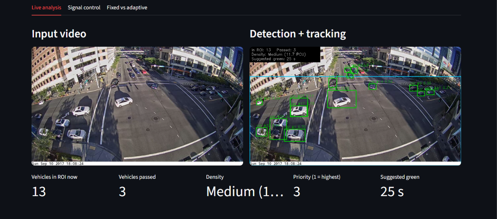
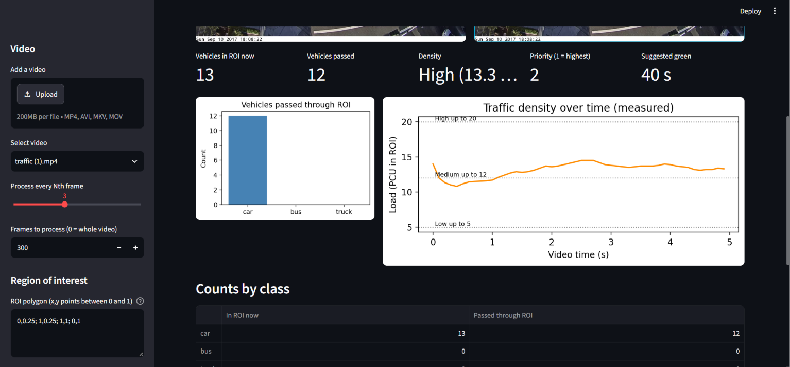
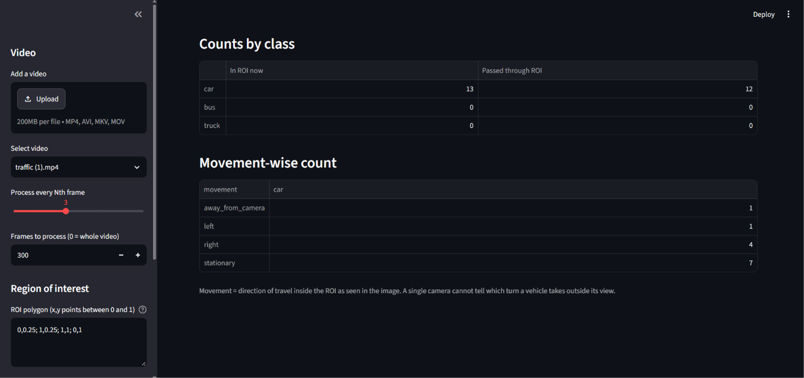
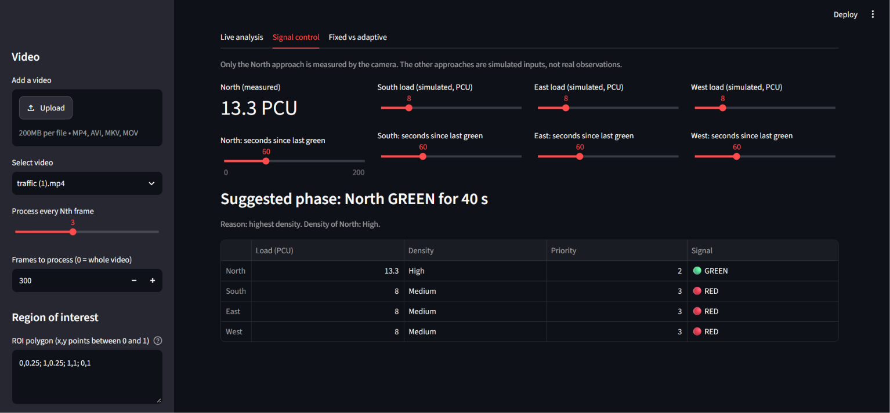
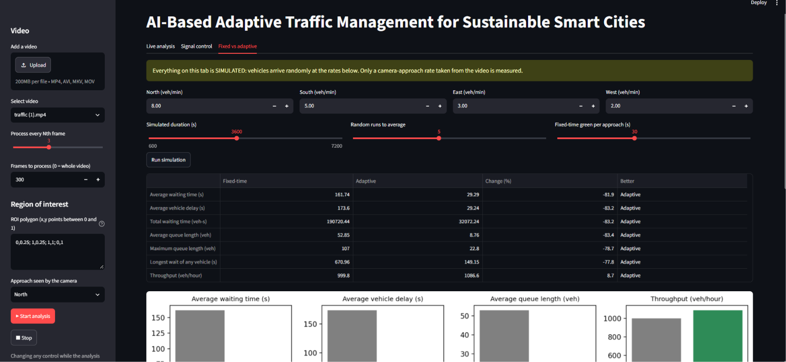
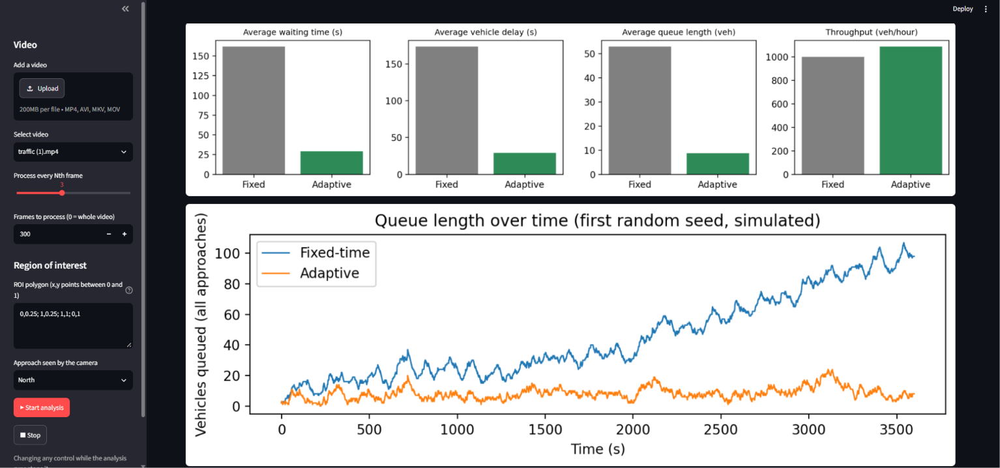

# AI-Based Adaptive Traffic Management System

This project analyses traffic videos using computer vision. It detects and tracks cars, buses, and trucks, counts vehicles in a selected region, estimates traffic density, and suggests a green signal duration.

It also includes a four-way intersection simulation that compares fixed-time and adaptive signal control.

The project is a prototype. It does not connect to or control real traffic lights.

## Screenshots

### Vehicle detection and tracking


### Traffic counts and density


### Vehicle movement


### Signal control


### Fixed-time and adaptive comparison



The screenshots show results from the traffic video and simulation settings used during testing. Results will vary with the input video and simulation settings.

## Features

- Detects cars, buses, and trucks using YOLO11n.
- Tracks vehicles between video frames using ByteTrack.
- Lets the user select a Region of Interest (ROI).
- Counts vehicles inside the ROI and vehicles that have passed through it.
- Estimates traffic load in Passenger Car Units (PCU).
- Classifies traffic density as Low, Medium, High, or Critical.
- Suggests a green signal duration based on traffic density.
- Includes fixed-time and adaptive signal control.
- Compares both signal methods in a four-way intersection simulation.
- Displays results and charts in a Streamlit dashboard.
- Saves analysis results as CSV files.

## Technologies

- Python
- YOLO11n and Ultralytics
- ByteTrack
- OpenCV
- Streamlit
- NumPy
- Pandas
- Matplotlib
- Python unittest

## Project Structure

```text
AI-Traffic-Management/
├── app.py
├── config.py
├── requirements.txt
├── data/
│   └── videos/
├── models/
├── outputs/
├── screenshots/
├── src/
│   ├── video_reader.py
│   ├── detector.py
│   ├── tracker.py
│   ├── roi.py
│   ├── vehicle_counter.py
│   ├── density_estimator.py
│   ├── signal_controller.py
│   ├── simulation.py
│   ├── performance.py
│   └── pipeline.py
└── tests/
    └── test_modules.py
```

## Requirements

- Python 3.10 or later
- pip
- Internet connection on the first run to download the YOLO11n model weights
- A traffic video in MP4, AVI, MKV, or MOV format

The application can run on a CPU. Processing speed depends on the computer and video settings.

## Installation

Open a terminal in the project folder, where `app.py` and `requirements.txt` are located.

### Windows

```powershell
python -m venv .venv
.venv\Scripts\activate
python -m pip install --upgrade pip
pip install -r requirements.txt
```

### macOS and Linux

```bash
python3 -m venv .venv
source .venv/bin/activate
python -m pip install --upgrade pip
pip install -r requirements.txt
```

## Run the Dashboard

Run this command from the project folder:

```bash
streamlit run app.py
```

Open the local URL shown in the terminal. It is usually `http://localhost:8501`.

1. Upload a traffic video or place one in `data/videos/`.
2. Select the video from the sidebar.
3. Set the frame skip and number of frames to process.
4. Set the ROI using normalised x,y coordinates between 0 and 1. Leave the field empty to use the full frame.
5. Select the approach shown by the camera.
6. Click **Start analysis**.
7. View the Live analysis, Signal control, and Fixed vs adaptive tabs.

The default frame limit is 300. Set it to `0` to process the full video.

## How It Works

1. OpenCV reads the video and prepares frames for processing.
2. YOLO11n detects cars, buses, and trucks.
3. ByteTrack assigns IDs to vehicles and follows them between frames.
4. The system checks which tracked vehicles are inside the selected ROI and counts vehicles that pass through it.
5. The density estimator calculates the traffic load in PCU and assigns a density level.
6. The signal controller uses the density level to suggest a green time.
7. The simulation compares fixed-time and adaptive signal control using generated vehicle arrivals.

## Signal Control and Simulation

The signal control tab uses the selected camera approach as the measured input. The other three approach loads are entered as simulated values. The dashboard displays the suggested phase, signal state, traffic load, and priority for each approach.

The Fixed vs adaptive tab runs a separate simulation for four approaches: North, South, East, and West. It compares waiting time, vehicle delay, queue length, and throughput over repeated runs.

Simulation results depend on the arrival rates and settings. They represent the behaviour of the simulation, not guaranteed results on real roads.

## Configuration

The main settings are in `config.py`. These include the vehicle classes, PCU weights, density limits, green signal durations, frame skip, and simulation settings.

The current PCU weights and signal timings are configurable values used by this prototype. They may need adjustment for different roads and camera positions.

## Run the Tests

From the project folder, run:

```bash
python -m unittest discover -s tests -v
```

The detector test requires the YOLO11n weights file at `models/yolo11n.pt`. If the file is not present, that test is skipped.

## Limitations

- A single camera only provides a view of one approach.
- Missed detections and tracking errors can affect vehicle counts.
- The movement label describes movement within the camera view. It cannot identify a vehicle's turn after it leaves the view.
- The detector currently counts cars, buses, and trucks.
- PCU weights, density limits, and signal timings are configurable values, not universal traffic standards.
- The signal controller is not connected to real traffic lights.
